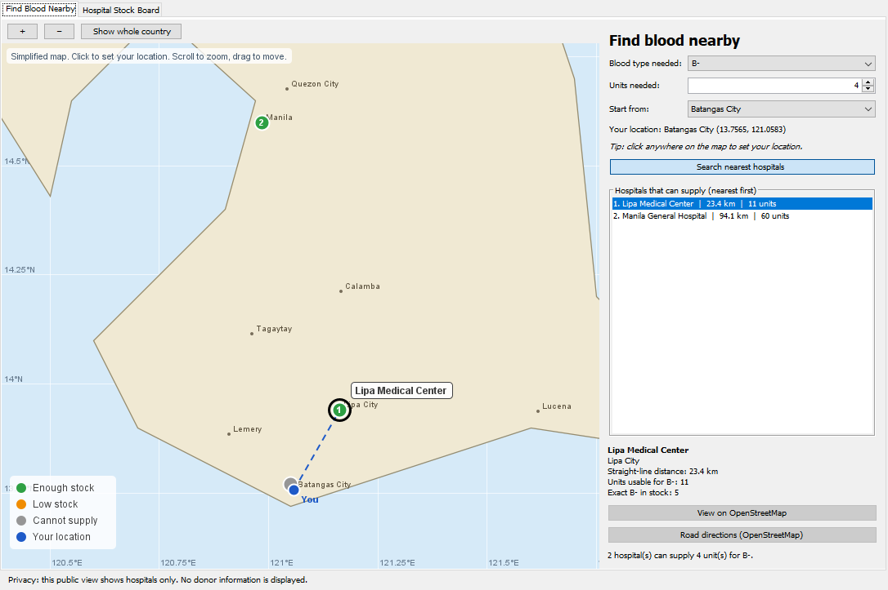
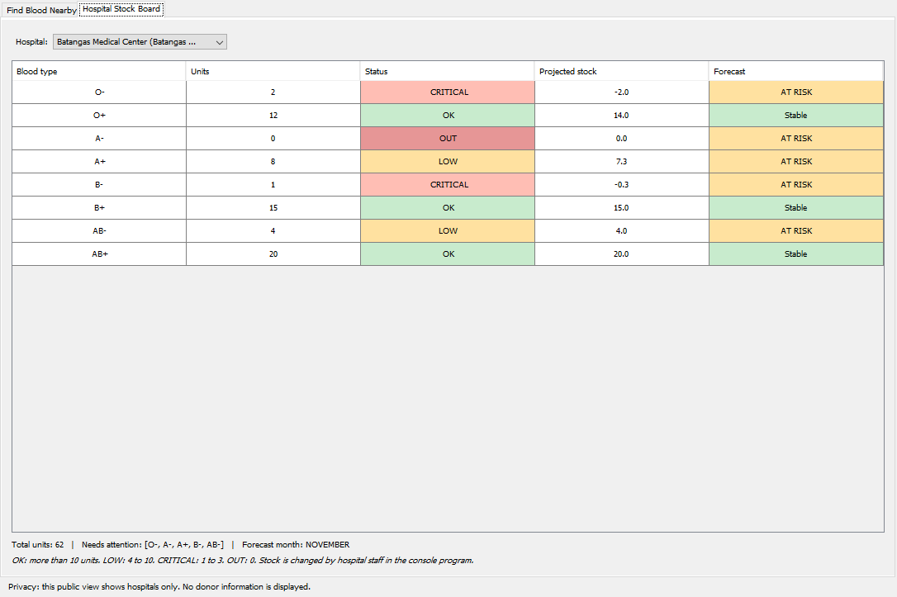
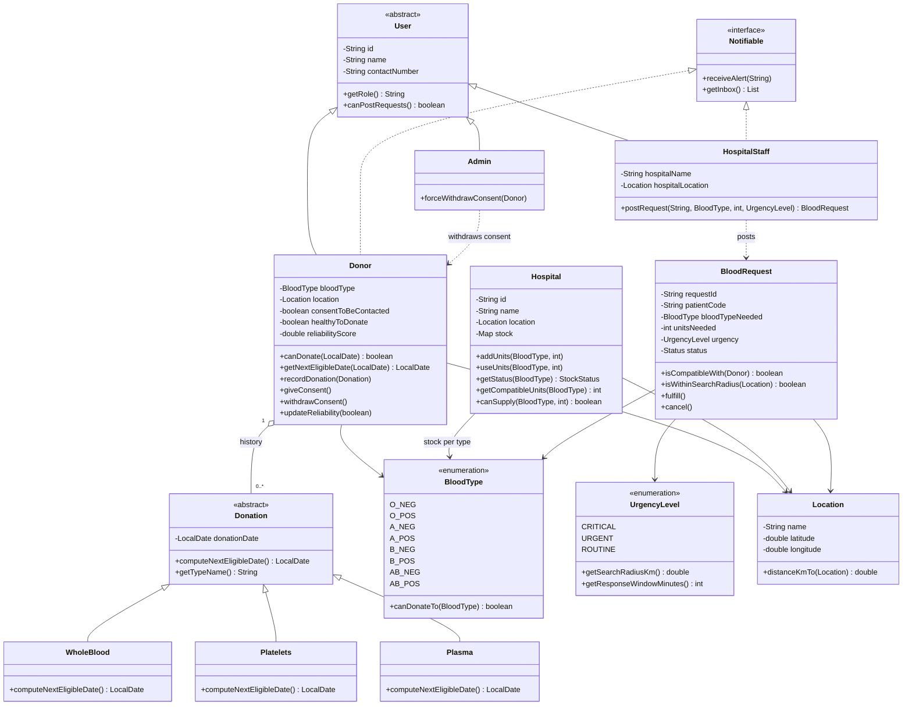
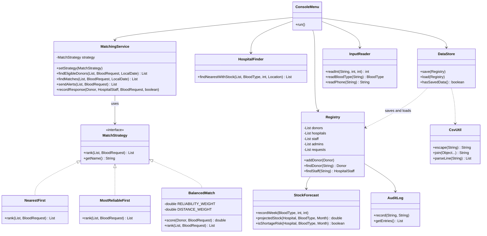
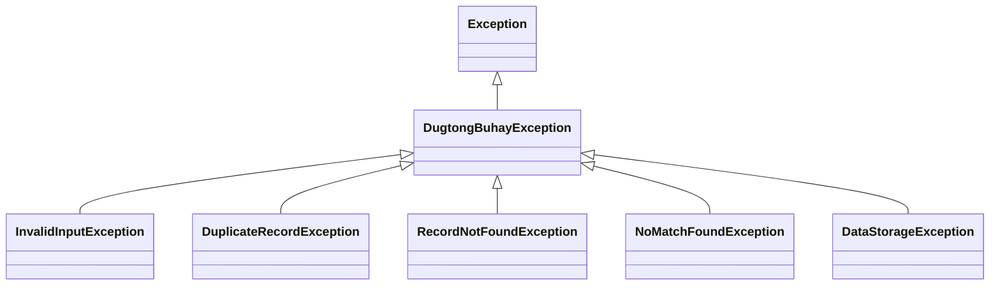

[UML-Diagram.md](https://github.com/user-attachments/files/35215768/UML-Diagram.md)
[README-1.md](https://github.com/user-attachments/files/35215591/README-1.md)
# DUGTONG-BUHAY

**Rare Blood Donor Matching and Emergency Response Network**

Group 14 | OOP 101 - Object-Oriented Programming | College of Informatics and Computing Sciences, Batangas State University - Alangilan Campus | 1st Semester, AY 2026-2027

---

## 1. Project Description

DUGTONG-BUHAY ("lifeline") is a Java application with a console interface and a Swing desktop app that helps hospitals in the provinces find **eligible, consenting blood donors** of the needed type quickly, and helps the public find **nearby hospitals that have the blood they need**.

The system:

- checks real blood-type compatibility (for example, O- can give to every type),
- computes each donor's next eligible donation date automatically,
- ranks donors using a swappable strategy (Nearest First, Most Reliable First, or Balanced),
- tracks each hospital's blood stock with low-stock warnings,
- forecasts which blood types may run short,
- saves all data to CSV files so nothing is lost when the program closes.

> **Disclaimer:** This is a classroom simulation. It is not medical advice. The waiting periods between donations are placeholder values and must be confirmed with the Philippine Red Cross or a licensed blood bank before any real use.

## 2. Problem Being Addressed

The Philippines has a continuing blood shortage, and B-negative is among the rarest types. In the provinces, a family that needs a specific blood type often has to search through Facebook posts and group chats, and hospitals have no quick way to find eligible donors nearby. Fewer donors also come forward during holiday periods while the need stays constant.

## 3. Project Objectives

**General objective:** To develop a donor matching and eligibility tracking system that helps hospitals in provinces find eligible, consenting blood donors of the needed type quickly, while protecting donor privacy and keeping blood donation voluntary.

**Specific objectives:**

1. Model donors, hospital staff, admins, donations, requests, and hospital stock as Java classes that use encapsulation, inheritance, abstraction, and polymorphism.
2. Match blood requests to compatible donors using blood-type rules, eligibility timers, consent, and distance.
3. Let the public find the nearest hospitals with the needed blood without exposing any donor's personal data.
4. Show each hospital's stock status and forecast possible shortages.
5. Validate all input and handle errors without crashing.
6. Save and reload data between runs.

## 4. Target Users

| User | What they do in the system |
|---|---|
| **Public / patient's family** | Search for nearby hospitals that have the needed blood type (no login needed) |
| **Hospital staff** | Manage stock, post emergency requests, see ranked donors, record donor replies |
| **Donors** | Register, give or withdraw consent, record donations, view alerts |
| **Admin** | Handle privacy requests, view the audit log and system summary |

## 5. Main Features

| Feature | Description |
|---|---|
| Blood compatibility engine | Matches by antigen rules, not only exact type |
| Emergency match alert | Alerts only consenting, eligible, compatible donors inside the search radius |
| Urgency levels | CRITICAL / URGENT / ROUTINE set the search radius and response time |
| Swappable ranking strategies | Nearest First, Most Reliable First, Balanced (mix of both) |
| Eligibility timer | Next donation date computed per donation type |
| Reliability score | Rises when a donor accepts an alert and falls when a donor declines |
| Hospital stock board | Stock per blood type with OK / LOW / CRITICAL / OUT warnings |
| Shortage forecast | Moving average of past usage and donations with a holiday factor |
| Public hospital search | Interactive Philippines map and nearest hospitals with enough compatible stock |
| Audit log | Records who did what and when |
| Data persistence | Autosaves to CSV files in the `data/` folder |
| Privacy by design | Opt-in consent, patient codes instead of names, contact details shared only after a donor accepts |

## 6. Technologies Used

- Java 17 or newer, with Swing for the desktop GUI
- `java.time` for dates, `java.nio.file` for file handling
- Visual Studio Code with the Extension Pack for Java
- Git and GitHub for version control

## 7. Team Members and Roles

| Name | Role |
|---|---|
| Pasamba, Carl Kendy Vincent A. | Team Leader, Main Programmer |
| Cadelino, John Andrei | UI/UX Design |
| Faltado, Rosceth | Documentation |

## 8. OOP Concepts Demonstrated

| Principle | Where it appears |
|---|---|
| **Encapsulation** | `Donor` keeps blood type, consent, and donation history private. `canDonate(date)` is the only eligibility check. `BloodRequest` has no setters and changes status only through `fulfill()` and `cancel()`. `Hospital` changes stock only through validated `addUnits()` and `useUnits()`. Lists are returned as read-only views. |
| **Inheritance** | `User` -> `Donor`, `HospitalStaff`, `Admin`. `Donation` -> `WholeBlood`, `Platelets`, `Plasma`. `DugtongBuhayException` -> five specific exceptions. |
| **Abstraction** | `abstract class User`, `abstract class Donation`, `interface MatchStrategy`, `interface Notifiable`. |
| **Polymorphism** | Each `Donation` overrides `computeNextEligibleDate()`. Each `MatchStrategy` overrides `rank()`. Each `User` overrides `getRole()` and `canPostRequests()`. `Notifiable` lets a `Donor` or a `HospitalStaff` receive alerts through one method. |
| **Composition** | `Donor` has a `Location` and a list of `Donation`. `Hospital` has a `Location` and a stock map. |

## 9. Project Structure

```
DugtongBuhay/
├── src/
│   ├── app/         Main, GuiMain, ConsoleMenu, InputReader, SystemTests
│   ├── gui/         MainWindow, FinderPanel, MapPanel, StockPanel
│   ├── model/       BloodType, Location, GeoUtils, User, Donor, HospitalStaff, Admin,
│   │                Donation, WholeBlood, Platelets, Plasma, UrgencyLevel,
│   │                BloodRequest, Hospital, Notifiable
│   ├── service/     MatchStrategy, NearestFirst, MostReliableFirst, BalancedMatch,
│   │                MatchingService, HospitalFinder, StockForecast, Registry, AuditLog,
│   │                PlaceCatalog, SampleData, CsvUtil, DataStore
│   └── exception/   DugtongBuhayException, InvalidInputException, DuplicateRecordException,
│                    RecordNotFoundException, NoMatchFoundException, DataStorageException
├── data/            CSV files created at run time (not committed to Git)
├── docs/            Project proposal, UML diagrams, testing evidence, presentation script
├── screenshots/     Screenshots used in this README and the testing evidence
└── README.md
```

## 10. How to Run the Program

**Requirements:** JDK 17 or newer, and VS Code with the *Extension Pack for Java* (or any terminal with `javac` and `java`).

**Option A: VS Code**

1. Clone the repository: `git clone https://github.com/kendyow/DUGTONG-BUHAY.git`
2. In VS Code, choose *File > Open Folder* and open the cloned `DUGTONG-BUHAY` folder.
3. Open `src/app/GuiMain.java` and click **Run** above `main`.
4. In the desktop window, use the public tabs or open **Hospital Staff**, **Donor**, or **Admin**.

**Option B: Terminal** (from the project folder)

Windows:
```
javac -encoding UTF-8 -d bin src\exception\*.java src\model\*.java src\service\*.java src\gui\*.java src\auth\*.java src\app\*.java
java -cp bin app.GuiMain
```

Mac / Linux:
```
javac -encoding UTF-8 -d bin src/exception/*.java src/model/*.java src/service/*.java src/gui/*.java src/auth/*.java src/app/*.java
java -cp bin app.GuiMain
```

The main window uses the same records for the public tabs and the role menus. Role dialogs accept the numbered options shown on screen. Use **Cancel** to return to the main window. To use the terminal menus, run `java -cp bin app.Main`. In **Find Blood Nearby**, select **B-**, **4** units, and **Batangas City**, then click **Search nearest hospitals**. Open **Hospital Stock Board** to view stock by hospital.

**Sample accounts (created on the first run):**

| Role | ID to type |
|---|---|
| Hospital staff | `S001` (Batangas Medical Center), `S002` (Lipa Medical Center) |
| Admin | `A001` |
| Donors | `D001` to `D008` |

**Run the automated tests:** run `src/app/SystemTests.java`, or in the terminal use `java -cp bin app.SystemTests`. All checks should print `PASS`.

**Run the password hashing tests:** use `java -cp bin app.PasswordHasherTests`.

**Reset the demo data:** delete the `data/` folder. The sample data is recreated on the next run.

## 11. Sample Screenshots

Add these files to the `screenshots/` folder, then keep the lines below.





## 12. Known Limitations

- Distances are straight-line (great-circle) distances, not road routes or travel times.
- The desktop app uses numbered dialogs for donor, staff, and admin workflows.
- The built-in map is an offline overview. OpenStreetMap directions require a browser and internet access.
- Login is by ID only, with no passwords.
- CSV files are plain text and not encrypted. A real deployment would need a secured database.
- Donor replies are entered by hospital staff to simulate a phone or app reply.
- Alerts are shown inside the program. No real SMS or email is sent.
- The Java shortage forecast uses a 3-week moving average with an assumed holiday factor.
- Waiting periods between donations are placeholders and not medical guidance.
- A donor's alert inbox is not saved between runs.
- Only one person can use the program at a time.

## 13. Future Improvements

- Real road distances through a routing service
- Database storage with password-protected accounts
- SMS or app notifications to donors
- A better forecasting model trained on real hospital data
- Integration with hospital and Red Cross systems

## 14. Project Contributors

| Member | Main contributions |
|---|---|
| Pasamba, Carl Kendy Vincent A. | Core Java application and Phase 9 Swing GUI integration. |
| Cadelino, John Andrei | menu design, screen flow, status colors |
| Faltado, Rosceth | README, test cases, screenshots, CSV tests |

Each member's work can be checked in the repository's commit history.

# DUGTONG-BUHAY UML Class Diagrams

Three diagrams: the domain model, the services, and the exceptions.

## How to turn these into the PNG the guidelines ask for (`docs/UML-Diagram.png`)

1. Go to **https://mermaid.live** in your browser.
2. Delete the sample code on the left, then paste **one diagram at a time**. Copy only the lines that start with `classDiagram` and stop before the closing three backticks. Do not copy the lines with the backticks or the word `mermaid`.
3. Click **Actions > PNG** (or *Download PNG*) and save it as `UML-Model.png`, `UML-Services.png`, and `UML-Exceptions.png` in the `docs/` folder.
4. Optional: in VS Code, install the extension **Markdown Preview Mermaid Support**, then press `Ctrl+Shift+V` on this file to preview the diagrams.

Legend: `<|--` inheritance, `<|..` implements an interface, `o--` has a collection of, `-->` uses or has, `..>` depends on.

---

## 1. Domain model



---

## 2. Services (matching, stock, storage)



---

## 3. Exceptions



