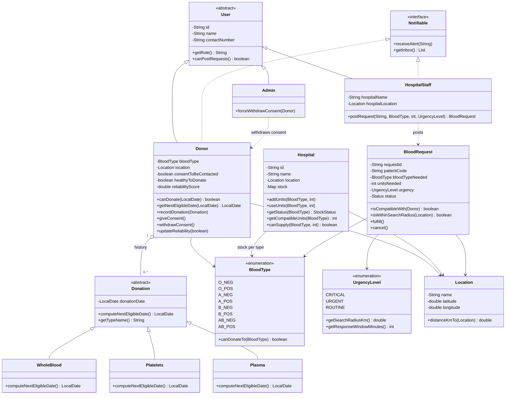
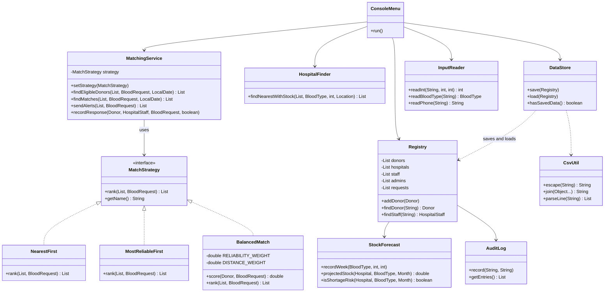
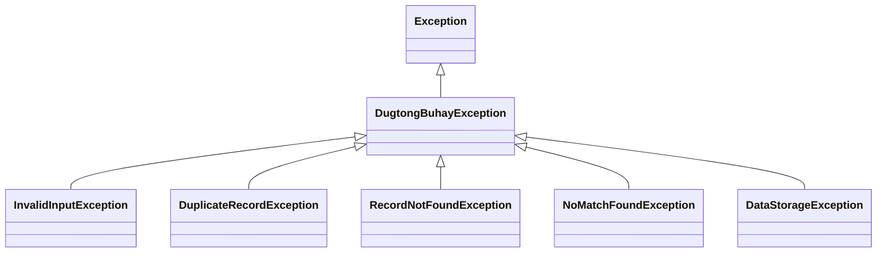

# DUGTONG-BUHAY UML Class Diagrams

Three diagrams: the domain model, the services, and the exceptions.

## How to turn these into the PNG the guidelines ask for (`docs/UML-Diagram.png`)

1. Go to **https://mermaid.live** in your browser.
2. Delete the sample code on the left, then paste **one diagram at a time**. Copy only the lines that start with `classDiagram` and stop before the closing three backticks. Do not copy the lines with the backticks or the word `mermaid`.
3. Click **Actions > PNG** (or *Download PNG*) and save it as `UML-Model.png`, `UML-Services.png`, and `UML-Exceptions.png` in the `docs/` folder.
4. Optional: in VS Code, install the extension **Markdown Preview Mermaid Support**, then press `Ctrl+Shift+V` on this file to preview the diagrams.

Legend: `<|--` inheritance, `<|..` implements an interface, `o--` has a collection of, `-->` uses or has, `..>` depends on.

---

## 1. Domain model

---

## 2. Services (matching, stock, storage)

---

## 3. Exceptions

